<div align="center">

# HHO-KOA-Ensemble

**Heterogeneous Multi-Backbone Ensemble with Harris Hawks Optimization of an Automated Knee Osteoarthritis Severity Grading System: A Dual-Dataset Study on Radiographic and Clinical Data**

Van Van Chau<sup>1</sup> · Minh Tuan Nguyen<sup>1</sup> · Phayung Meesad<sup>2,*</sup>

<sup>1</sup> Faculty of Information Technology, Posts and Telecommunications Institute of Technology, Vietnam<br>
<sup>2</sup> Department of Information Technology Management, King Mongkut's University of Technology North Bangkok, Thailand<br>
<sup>*</sup> Corresponding author

*Artificial Intelligence and Applications* (Bon View Publishing), manuscript #11263, 2026


| QWK, HHO+TTA | Macro-AUC | Balanced Acc | HHO vs. uniform weights | Features, clinical branch |
|:--:|:--:|:--:|:--:|:--:|
| **0.8279** | **0.8909** | **68.6%** | ΔQWK +0.0002, p = 0.47 | **12 / 67** |

</div>

---

**Contents:**
[Summary](#summary) ·
[Figures](#figures) ·
[Tables](#tables) ·
[Repository structure](#repository-structure) ·
[Reproduction](#setup-and-reproduction) ·
[Data](#data) ·
[Citation](#citation)

This repository holds the code, cached predictions, run logs, tables and figures for the manuscript. The released prediction cache lets anyone re-run the Phase 2 analyses on a CPU in a few minutes, without any images.

---

## Summary

Knee osteoarthritis (KOA) severity is graded manually on the five-point Kellgren–Lawrence (KL) scale, with marked inter-reader variability. The study proposes a two-phase pipeline:

- **Phase 1:** DenseNet-121, EfficientNetV2-S, ResNet-50 and ConvNeXt-Tiny are fine-tuned with a combined CORN ordinal loss and boundary-sensitive focal loss (BSFL). Layer-wise learning-rate decay (LLRD) is used for ConvNeXt-Tiny only.
- **Phase 2:** Harris Hawks Optimization (HHO) searches the soft-voting weights that maximize validation quadratic weighted kappa (QWK). HHO is compared with PSO and GA, both for the deployed seed and over 30 independent runs.
- **Clinical branch:** HHO feature selection with an SVM, run on 160 patients.

On 8,260 OAI radiographs split at subject level, the HHO ensemble reaches **QWK 0.8177 / macro-AUC 0.8871**. Eight-variant test-time augmentation (TTA) raises these to **QWK 0.8279 / macro-AUC 0.8909**.

A paired bootstrap shows that the gain over uniform weighting is small and **not significant**. Across 30 runs, HHO matches PSO and GA in solution quality but shows no robust convergence-speed advantage. HHO is therefore presented as a weight-search strategy of comparable quality, not as a source of accuracy or speed gains.

### Contributions

1. A four-backbone fine-tuning pipeline with a combined CORN + BSFL loss, and LLRD for ConvNeXt-Tiny.
2. An HHO ensemble weight search on validation QWK that improves on every single backbone. A bootstrap test shows that its margin over uniform weighting is not significant.
3. A 30-run comparison of HHO, PSO and GA. Validation QWK is:
   - marginally but significantly higher for HHO than for PSO (p = 0.0028);
   - indistinguishable between HHO and GA (p = 0.28).

   No optimizer converges robustly faster than the others.
4. A dual-dataset evaluation that pairs OAI radiographic grading with an HHO-selected SVM pathway on 160 patients.
5. A qualitative Grad-CAM analysis across all four backbones and all five KL grades.

## Figures

<p align="center">
  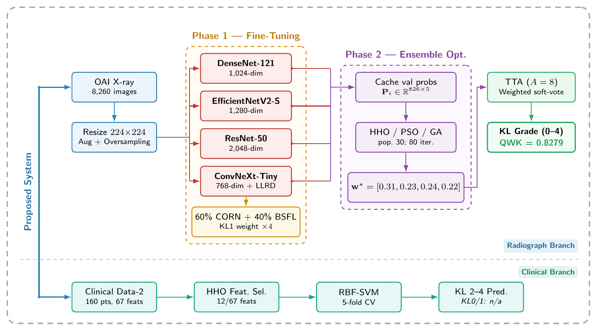<br>
  <em><b>Figure 1.</b> Two-phase KOA grading pipeline with the parallel clinical branch</em>
</p>

<p align="center">
  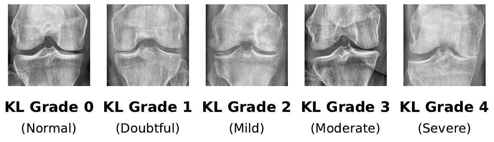<br>
  <em><b>Figure 2.</b> One OAI radiograph per KL grade</em>
</p>

<table align="center">
  <tr>
    <td align="center">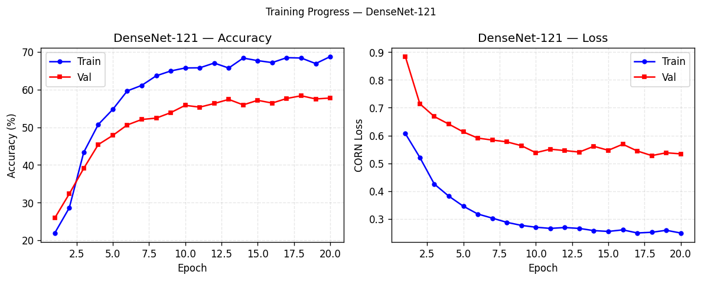<br><sub>(a) DenseNet-121</sub></td>
    <td align="center">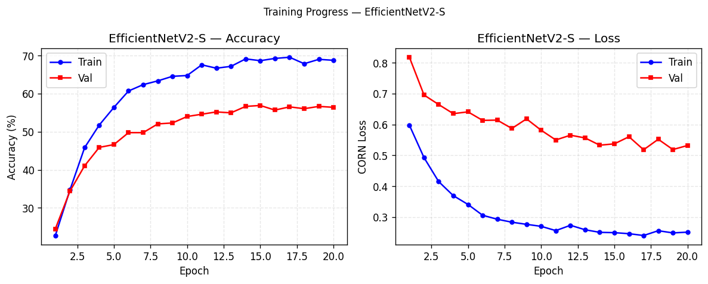<br><sub>(b) EfficientNetV2-S</sub></td>
  </tr>
  <tr>
    <td align="center">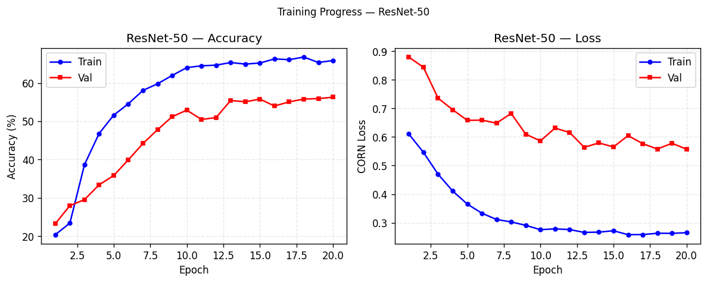<br><sub>(c) ResNet-50</sub></td>
    <td align="center">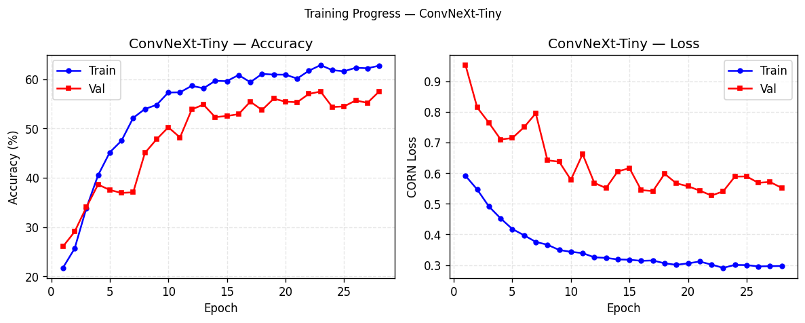<br><sub>(d) ConvNeXt-Tiny</sub></td>
  </tr>
</table>
<p align="center"><em><b>Figure 3.</b> Training curves of the four backbones</em></p>

<p align="center">
  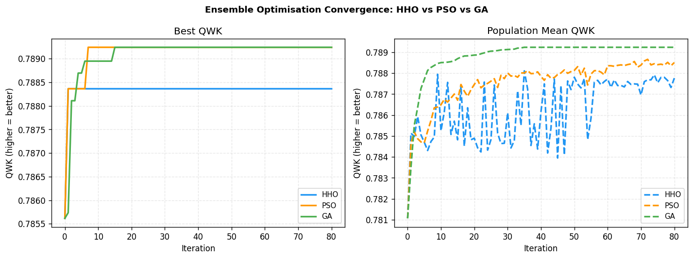<br>
  <em><b>Figure 4.</b> Convergence of HHO, PSO and GA for the deployed seed</em>
</p>

<p align="center">
  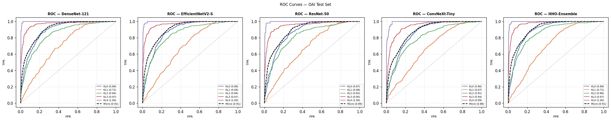<br>
  <em><b>Figure 5.</b> Macro-averaged one-vs-rest ROC curves on the OAI test set</em>
</p>

<p align="center">
  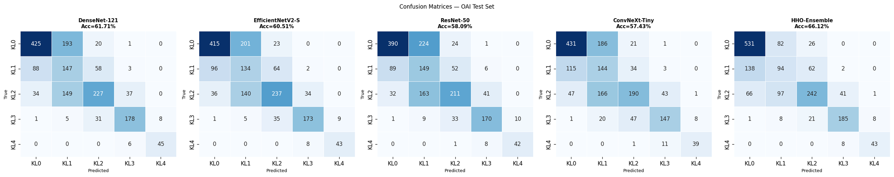<br>
  <em><b>Figure 6.</b> Row-normalized confusion matrices of the four backbones and the HHO ensemble</em>
</p>

<table align="center">
  <tr>
    <td align="center">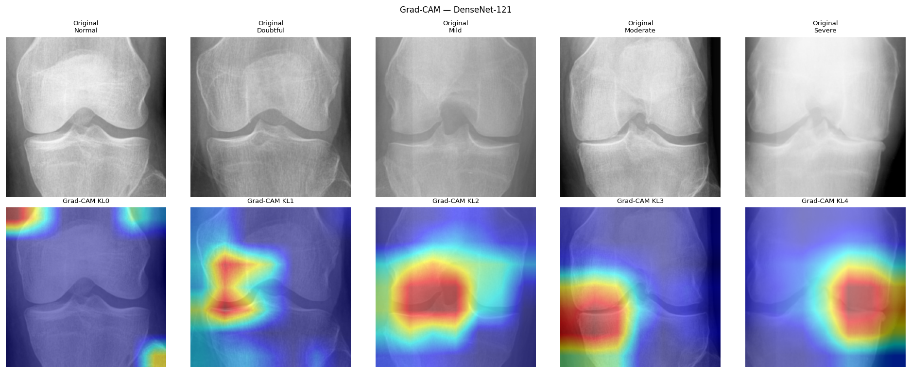<br><sub>(a) DenseNet-121</sub></td>
    <td align="center">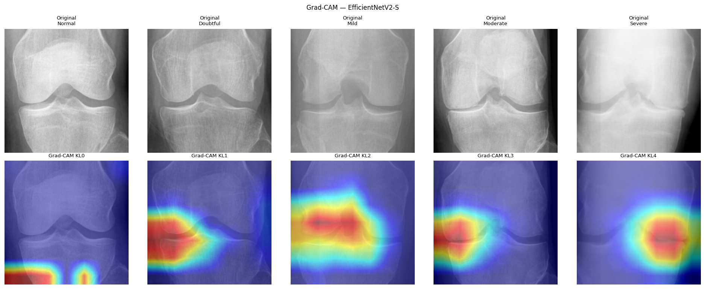<br><sub>(b) EfficientNetV2-S</sub></td>
  </tr>
  <tr>
    <td align="center">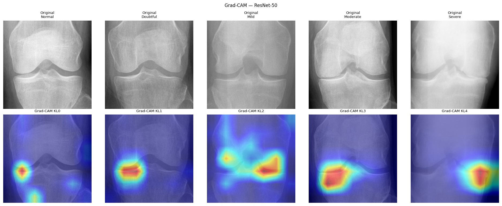<br><sub>(c) ResNet-50</sub></td>
    <td align="center">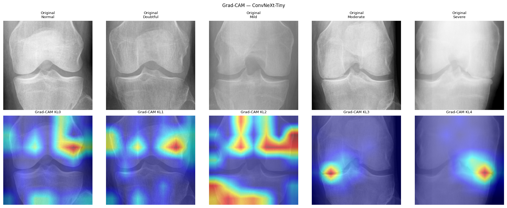<br><sub>(d) ConvNeXt-Tiny</sub></td>
  </tr>
</table>
<p align="center"><em><b>Figure 7.</b> Grad-CAM maps per KL grade for the four backbones</em></p>

---

## Tables

**Table 3.** Settings for fine-tuning and ensemble optimization

| Hyperparameter | Value |
|:--|:--|
| Dataset | OAI, 8,260 images, KL 0–4 |
| Random seed | 42, data split and initialization |
| Split, subject-level | 5,778 / 826 / 1,656 |
| Image size | 224×224 px |
| Oversampling exponent | β = 0.7 |
| Loss | 60% CORN + 40% BSFL, γ = 2 |
| KL 1 weight | 4× inverse-frequency weight |
| Optimizer | AdamW |
| Head LR | 1e-4 default; 5e-5 ConvNeXt-Tiny |
| Backbone LR | 0.1× head LR |
| LLRD | decay 0.65 over 6 groups, ConvNeXt-Tiny only |
| Warm-up | 5 epochs, ConvNeXt-Tiny only |
| Max epochs | 20 default; 30 ConvNeXt-Tiny |
| Early stopping | patience 5 epochs |
| Ensemble search | population 30, 80 iterations |
| TTA | 8 deterministic variants |
| Framework | PyTorch 2.1, timm, coral-pytorch |

**Table 5.** Ordinal metrics per backbone and ensemble on the OAI test set, without TTA

| Model | QWK | MAE | AUC | Acc (%) |
|:--|--:|--:|--:|--:|
| DenseNet-121 | 0.8143 | 0.423 | 0.8816 | 61.7 |
| EfficientNetV2-S | 0.8082 | 0.436 | 0.8741 | 60.5 |
| ResNet-50 | 0.7913 | 0.465 | 0.8638 | 58.1 |
| ConvNeXt-Tiny | 0.7754 | 0.484 | 0.8543 | 57.4 |
| Uniform ensemble | 0.8168 | 0.409 | 0.886 | 64.7 |
| HHO-Ensemble | 0.8177 | 0.402 | 0.8871 | 66.1 |

**Table 6.** Optimizer comparison for the deployed seed 42, population 30, 80 iterations

| Optimizer | Best val QWK | Converge (iter) | Time (s) |
|:--|--:|--:|--:|
| PSO | 0.7892 | 7 | 0.81 |
| GA | 0.7892 | 15 | 1.57 |
| HHO | 0.7884 | 1 | 0.85 |

Deployed HHO weights: DenseNet-121 0.307, EfficientNetV2-S 0.231, ResNet-50 0.238, ConvNeXt-Tiny 0.224.

**Table 7.** Optimizer comparison over 30 independent runs, seeds 0–29, fixed backbone caches

| Optimizer | Val QWK | Test QWK | Median iter (IQR) |
|:--|--:|--:|--:|
| PSO | 0.7875 ± 0.0008 | 0.8278 ± 0.0011 | 0 (0–0) |
| GA | 0.7877 ± 0.0006 | 0.8282 ± 0.0011 | 0 (0–10) |
| HHO | 0.7879 ± 0.0009 | 0.8279 ± 0.0012 | 1 (0–1) |

Wilcoxon signed-rank test on per-seed validation QWK: HHO vs. PSO p = 0.0028, HHO vs. GA p = 0.28.

**Table 8.** Full evaluation on the OAI test set, 1,656 images; the first six rows are without TTA

| Configuration | Acc (%) | BalAcc (%) | QWK | AUC |
|:--|--:|--:|--:|--:|
| DenseNet-121 | 61.7 | 67.0 | 0.8143 | 0.8816 |
| EfficientNetV2-S | 60.5 | 65.0 | 0.8082 | 0.8741 |
| ResNet-50 | 58.1 | 63.4 | 0.7913 | 0.8638 |
| ConvNeXt-Tiny | 57.4 | 60.2 | 0.7754 | 0.8543 |
| Unif-Ens | 64.7 | 66.1 | 0.8168 | 0.886 |
| HHO-Ens | 66.1 | 67.3 | 0.8177 | 0.8871 |
| Unif-Ens+TTA | 66.9 | 68.8 | 0.8277 | 0.8908 |
| SOTA, Vaattovaara et al. | – | 69.3 | 0.820 | 0.886 |
| HHO-Ens+TTA | 66.6 | 68.6 | 0.8279 | 0.8909 |

None of the differences between Unif-Ens+TTA and HHO-Ens+TTA is significant.

**Table 9.** Paired bootstrap validation with TTA, B = 10,000, seed 42

| Comparison | Point ΔQWK | 95% CI | p |
|:--|--:|:--:|--:|
| HHO vs. M1, uniform ensemble | +0.0002 | [−0.0038, 0.0043] | 0.47 |
| HHO vs. M2, EfficientNetV2-S+TTA | +0.0081 | [−0.0032, 0.0196] | 0.08 |

**Table 10.** Per-class metrics of HHO-Ensemble on the OAI test set

| Class | Rec | Pre | F1 | Rec, TTA | Pre, TTA | F1, TTA |
|:--|--:|--:|--:|--:|--:|--:|
| KL 0 Normal | 0.83 | 0.72 | 0.77 | 0.83 | 0.74 | 0.78 |
| KL 1 Doubtful | 0.32 | 0.33 | 0.33 | 0.33 | 0.33 | 0.33 |
| KL 2 Mild | 0.54 | 0.69 | 0.61 | 0.54 | 0.69 | 0.60 |
| KL 3 Moderate | 0.83 | 0.78 | 0.81 | 0.84 | 0.78 | 0.81 |
| KL 4 Severe | 0.84 | 0.83 | 0.83 | 0.88 | 0.85 | 0.87 |
| Macro avg | 0.67 | 0.67 | 0.67 | 0.69 | 0.68 | 0.68 |

**Table 11.** Ablation study on the OAI test set

| Configuration | QWK | BalAcc (%) |
|:--|--:|--:|
| − TTA, no TTA | 0.8177 | 67.3 |
| − HHO, uniform ensemble + TTA | 0.8277 | 68.8 |
| − LLRD, ConvNeXt-Tiny | 0.8094 | 65.8 |
| − BSFL, λ_f = 0 | 0.8065 | 63.2 |
| − CORN, CE loss | 0.8053 | 62.9 |
| − HHO − TTA, uniform without TTA | 0.8168 | 66.1 |
| Full pipeline, HHO + TTA | 0.8279 | 68.6 |

**Table 12.** Validation results on Clinical Data-2, stratified 5-fold CV, n = 160, KL 2–4

| Method | Acc | F1 | Features |
|:--|--:|--:|--:|
| Full-feature SVM | 0.525 ± 0.036 | 0.364 ± 0.023 | 67/67 |
| HHO + SVM | 0.419 ± 0.102 | 0.339 ± 0.100 | 12/67 |

**Table 13.** Computational cost summary, Apple M-series, MPS backend

| Stage | Cost |
|:--|:--|
| Phase 1: DenseNet-121 | ~42 min |
| Phase 1: EfficientNetV2-S | ~68 min |
| Phase 1: ResNet-50 | ~55 min |
| Phase 1: ConvNeXt-Tiny | ~175 min |
| Phase 1: total | ~5.8 h |
| Phase 2: HHO optimization | 0.85 s |
| Inference, no TTA | ~12 ms/image |
| Inference, TTA A = 8 | ~96 ms/image |

All tables are also provided as CSV files in `results/tables/`.

---

## Repository structure

```
.
├── README.md
├── requirements.txt
├── config.py               # hyperparameters, manuscript Table 3
├── train.py                # Phase 1: backbone fine-tuning, CORN+BSFL, LLRD + warm-up
├── ensemble_optimize.py    # Phase 2: HHO / PSO / GA weight search on validation QWK
├── evaluate.py             # test metrics + paired bootstrap, Table 9
├── reproduce_tables.py     # regenerates Tables 7, 8 (TTA rows), 9, 10 from data/
├── src/
│   ├── models/backbones.py         # CORN head on timm backbones, Eq. 1-2
│   ├── losses/corn_bsfl.py         # combined CORN + BSFL loss, Eq. 3-5
│   ├── optim/{hho,pso,ga}.py       # ensemble weight optimizers, Algorithm 1, Eq. 7
│   ├── data/dataset.py             # OAI loader, augmentation, oversampling
│   ├── clinical/feature_selection.py  # HHO wrapper feature selection + SVM
│   └── metrics.py                  # QWK (Eq. 8), balanced accuracy, macro-AUC
├── data/tta8_probs.npz     # cached TTA-8 class probabilities (val 826, test 1,656)
├── logs/                   # original run logs
├── results/
│   ├── tables/             # manuscript Tables 3, 5-13 as CSV
│   └── reproduced/         # output of reproduce_tables.py
└── figures/                # manuscript Figures 1-7
```

## Setup and reproduction

```bash
git clone https://github.com/vancv43/hho-koa-ensemble.git
cd hho-koa-ensemble
pip install -r requirements.txt

# Phase 2 analyses from the released cache (CPU, a few minutes)
python reproduce_tables.py

# Phase 1 fine-tuning (requires your own OAI export)
export KOA_DATA_ROOT=/path/to/oai   # train/ val/ test/ with one folder per KL grade 0-4
python train.py --backbone densenet121
python train.py --backbone convnext_tiny   # LLRD + 5-epoch warm-up applied automatically
```

### Reproducibility status

| Manuscript item | Source in this repository | Status |
|:--|:--|:--|
| Table 5, Table 8 (rows without TTA) | `logs/01_*`, `logs/03_*` | original run log |
| Table 6, deployed HHO weights | `logs/13_*` | original run log |
| Table 7 | `reproduce_tables.py` | regenerated exactly from `data/` |
| Table 8 (TTA rows) | `reproduce_tables.py` | regenerated exactly from `data/` |
| Table 9 | `reproduce_tables.py` | regenerated exactly from `data/` |
| Table 10 | `logs/07_*`, `reproduce_tables.py` | log, and regenerated exactly from `data/` |
| Table 12 | `logs/01_*`, per-fold values | original run log |
| Table 11 (TTA and HHO rows) | Tables 8–9 | regenerated exactly |
| Table 11 (LLRD, BSFL, CORN rows) | — | reported values, no run log released |
| Table 13 (Phase 2 time) | `logs/13_*` | original run log |
| Table 13 (other timings) | — | approximate wall-clock values |

Notes:
- Table 6 comes from the original pipeline run. Running the released optimizers with seed 42 gives the same solution quality but not the same iteration-by-iteration trajectory.
- The 30-run analysis in Table 7 used the released optimizers.
- A run is counted as converged at the first iteration whose best-so-far fitness reaches 0.999 × the final best.

## Data

- **OAI radiographs** are not redistributed. They are available from the NIMH Data Archive (https://nda.nih.gov/oai) under the OAI data use agreement.
- **Cached predictions:** `data/tta8_probs.npz` holds only per-image class probabilities and KL labels for the validation and test splits. It contains no images and no subject identifiers.
- **Clinical Data-2** (160 patients, 67 features) is confidential under the ethics approval and data partner agreement, so it is not released. `src/clinical/feature_selection.py` runs on any `(X, y)` matrix of the same form.
- **Checkpoints** of the trained models are not included.

## Limitations

- All headline OAI metrics come from one fixed subject-level split.
- Multi-seed backbone retraining and external multisite validation are still open.
- The Grad-CAM analysis is qualitative and was not scored by radiologists.
- The code is for research use only and is not a medical device.

## Citation

```bibtex
@article{chau2026hhokoa,
  title   = {Heterogeneous Multi-Backbone Ensemble with Harris Hawks Optimization of an
             Automated Knee Osteoarthritis Severity Grading System: A Dual-Dataset Study
             on Radiographic and Clinical Data},
  author  = {Chau, Van Van and Nguyen, Minh Tuan and Meesad, Phayung},
  journal = {Artificial Intelligence and Applications},
  year    = {2026}
}
```
